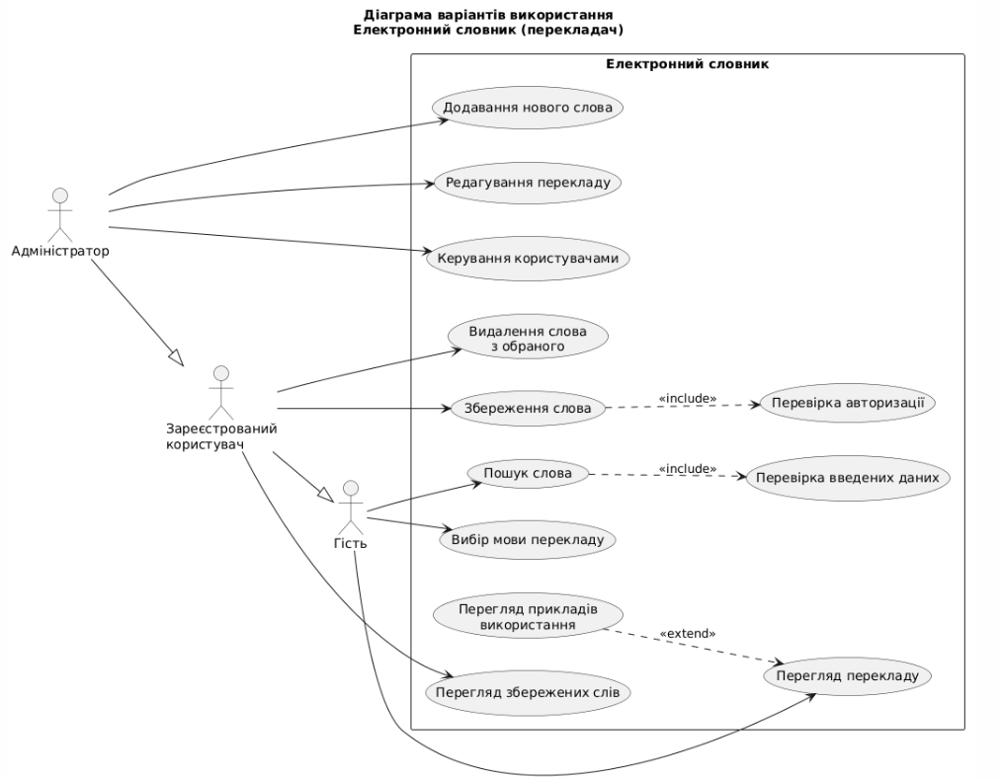
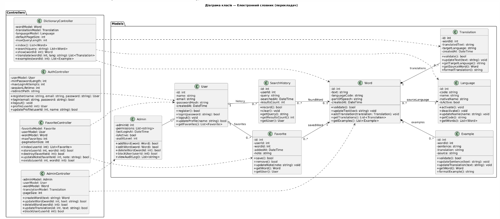

# Лабораторна робота №2
## Проєктування архітектури вебзастосунку
### Варіант 2. Електронний словник (перекладач)

## 1. Мета роботи

Провести аналіз предметної області електронного словника,
визначити функціональні вимоги та ролі користувачів,
розробити сценарії використання і UML-діаграми,
спроєктувати основні компоненти вебзастосунку
з використанням архітектурного підходу MVC.

## 2. Опис предметної області

Електронний словник (перекладач) — це вебзастосунок,
який дозволяє користувачам шукати слова,
отримувати їх переклади різними мовами,
переглядати приклади використання та зберігати
потрібні слова для подальшого вивчення.

Система призначена для студентів, викладачів,
перекладачів та інших користувачів, які вивчають
іноземні мови.

Адміністратор відповідає за актуальність словникових
записів та керування користувачами.

## 3. Функціональні вимоги

FR-01. Пошук слова за введеним текстом.

FR-02. Перегляд перекладу знайденого слова.

FR-03. Вибір мови перекладу.

FR-04. Реєстрація та авторизація користувачів.

FR-05. Збереження слів у персональному списку.

FR-06. Перегляд та видалення збережених слів.

FR-07. Перегляд прикладів використання слів.

FR-08. Додавання нових словникових записів адміністратором.

FR-09. Редагування та видалення словникових записів.

FR-10. Керування обліковими записами користувачів.

FR-11. Збереження історії пошукових запитів.

## 4. Ролі користувачів

### 4.1. Гість
- Шукає слова.
- Переглядає переклади.
- Обирає мову перекладу.
- Може зареєструватися або увійти до системи.

### 4.2. Зареєстрований користувач
- Має всі можливості гостя.
- Зберігає слова в обраному.
- Переглядає та видаляє збережені слова.
- Може переглядати історію пошуку.

### 4.3. Адміністратор
- Має можливості зареєстрованого користувача.
- Додає нові слова до словника.
- Редагує та видаляє переклади.
- Керує користувачами.

## 5. Сценарії використання (Use Cases)

### UC-01. Пошук слова — короткий формат

**Актор:** Гість.

**Мета:** Знайти переклад введеного слова.

**Основний сценарій:** Користувач вводить слово,
обирає мову перекладу та натискає кнопку пошуку.
Система перевіряє запит, знаходить відповідний
словниковий запис і показує переклад.

**Результат:** Користувач отримує переклад слова.

### UC-02. Збереження слова — довільний формат

**Актор:** Зареєстрований користувач.

Користувач входить до системи, знаходить потрібне
слово через пошук і відкриває його картку.
Після натискання кнопки «Додати до обраного»
система перевіряє авторизацію та наявність
слова у списку збережених. Якщо слово ще не
збережене, система додає його до обраного
і показує повідомлення про успішну операцію.

Якщо слово вже є у списку, система повідомляє
користувача, що повторне збереження не потрібне.

### UC-03. Додавання словникового запису — повний формат

**Назва:** Додавання нового слова до електронного словника.

**Основний актор:** Адміністратор.

**Мета:** Створити новий словниковий запис
із перекладом та прикладом використання.

**Передумови:**
- Адміністратор авторизований.
- Адміністратор має право редагувати словник.
- Система та база даних доступні.

**Тригер:** Адміністратор натискає «Додати слово».

**Основний успішний сценарій:**

1. Адміністратор відкриває панель керування словником.
2. Система відображає список словникових записів.
3. Адміністратор натискає кнопку «Додати слово».
4. Система відкриває форму створення запису.
5. Адміністратор вводить нове слово.
6. Адміністратор обирає мову вихідного слова.
7. Адміністратор вказує частину мови.
8. Адміністратор вводить текст перекладу.
9. Адміністратор обирає цільову мову перекладу.
10. Адміністратор вводить приклад використання слова.
11. Адміністратор натискає кнопку «Зберегти».
12. Система перевіряє правильність введених даних.
13. Система перевіряє, чи не існує аналогічного запису.
14. Система створює запис слова та пов'язаний переклад.
15. Система зберігає приклад використання.
16. Система показує повідомлення про успішне додавання.

**Альтернативні потоки:**

**A1. Не заповнено обов'язкове поле (крок 12).**
Система підсвічує незаповнені поля та пропонує
адміністратору доповнити форму. Повернення до кроку 5.

**A2. Некоректна мова перекладу (крок 12).**
Система показує помилку вибору мови.
Адміністратор обирає доступну мову.
Повернення до кроку 9.

**A3. Слово вже існує у словнику (крок 13).**
Система повідомляє про можливий дублікат
і пропонує відкрити наявний запис.
Адміністратор може скасувати додавання
або повернутися до редагування форми.

**A4. Недостатньо прав доступу (крок 1).**
Система відмовляє у доступі до панелі
адміністрування та показує повідомлення про помилку.
Сценарій завершується без змін.

**A5. Помилка збереження до бази даних (крок 14).**
Система скасовує незавершені зміни,
показує повідомлення про технічну помилку
та дозволяє повторити операцію.

**A6. Адміністратор скасовує створення (кроки 4–11).**
Система закриває форму без збереження запису.

**Постумови успішного завершення:**
- Нове слово збережене в базі даних.
- Переклад пов'язаний зі словом.
- Приклад використання доступний для перегляду.

**Мінімальна гарантія:** У разі помилки система
не створює неповний словниковий запис.

## 6. Логічні сутності предметної області

1. User — користувач системи.
2. Word — словникове слово.
3. Translation — переклад слова.
4. Language — мова.
5. Example — приклад використання.
6. Favorite — збережене користувачем слово.
7. SearchHistory — історія пошуку.

## 7. Проєктування бази даних

Планується використання реляційної бази даних.

| Таблиця | Основні поля | Призначення |
|---|---|---|
| users | id, name, email, password, role | Користувачі та їхні ролі |
| languages | id, code, name, native_name, is_active | Доступні мови |
| words | id, text, language_id, part_of_speech | Словникові слова |
| translations | id, word_id, target_language_id, translated_text | Переклади |
| examples | id, word_id, sentence, translation | Приклади використання |
| favorites | id, user_id, word_id, added_at | Збережені слова |
| search_histories | id, user_id, query, searched_at | Історія пошуку |

Основні зв'язки:
- Один користувач може зберегти багато слів.
- Одне слово може мати багато перекладів.
- Одне слово може мати багато прикладів.
- Кожне слово належить до певної мови.
- Користувач може мати багато записів історії пошуку.

## 8. Вихідні дані та представлення результатів

**1. Таблиця результатів пошуку:**
слово, мова, переклад, частина мови.

**2. Звіт про активність користувача:**
кількість пошукових запитів та збережених слів.

**3. Діаграма статистики словника:**
кількість словникових записів за мовами.

## 9. Архітектура MVC

Для майбутньої реалізації передбачається
використання PHP та фреймворку Laravel.

**Model:** User, Admin, Word, Translation, Language,
Example, Favorite, SearchHistory.

**View:** сторінка пошуку, сторінка перекладу,
список збережених слів, панель адміністратора.

**Controller:** DictionaryController, FavoriteController,
AdminController, AuthController.

Контролери обробляють запити, звертаються
до моделей та передають дані для відображення.

## 10. UML-діаграма варіантів використання

Вихідний код діаграми:
[use-case-diagram.puml](diagrams/use-case-diagram.puml)

## 11. UML-діаграма класів

Вихідний код діаграми:
[class-diagram.puml](diagrams/class-diagram.puml)

## 12. Висновок

У ході лабораторної роботи проведено аналіз
предметної області електронного словника,
визначено функціональні вимоги та ролі користувачів,
розроблено три сценарії використання різного рівня
деталізації та створено UML-діаграми.

Спроєктовано основні сутності бази даних
і компоненти архітектури MVC.
Отримана модель може бути використана
як основа для подальшої розробки вебзастосунку
засобами PHP та Laravel.
